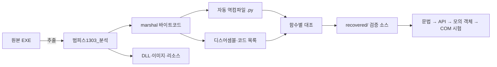

# 프로젝트 구조

> 2026-09-29 현재 폴더 위치는 [전체 디렉터리 안내](DIRECTORY_LAYOUT.md)를 기준으로 한다. 아래는 복구 초기의 분석·복구 구조 설명이며 현재 사용자 문서 위치나 제품 실행 안내가 아니다. 원본 실행파일·가이드는 `originals/`, 사용자 문서·첨부자료는 `materials/`, 현재 프로그램 개발은 `new_project/`에서 관리한다.

## 데이터 흐름



## 분석 디렉터리

```text
범피스1303_분석/
├─ analysis/             메인 코드 목록·import·문자열·디스어셈블
├─ decompiled/           자동 역컴파일된 메인 코드
├─ decompiled_modules/   자동 역컴파일된 PYZ 내부 모듈
├─ extracted/            PyInstaller에서 꺼낸 코드와 실행 리소스
├─ pyz_modules/          내부 모듈별 원본 marshal
├─ python313/            분석용 Python 3.13 임베디드 런타임
├─ pycdc/                Python 3.13 대응 역컴파일 도구
├─ run_extracted.py      추출 바이트코드 로더 — 실행 주의
└─ 진행현황.md            기존 분석 결과 요약
```

## 복구 디렉터리

현재 복구 작업은 [새 프로젝트 트리](NEW_PROJECT_TREE.md)를 기준으로 진행한다.

```text
recovered/
├─ app/
├─ workflows/
├─ README.md
├─ 복구현황.md
├─ 인터페이스/
│  ├─ __init__.py
│  └─ 인터페이스.py
├─ 피피티/
│  ├─ connection.py
│  ├─ shapes.py
│  ├─ slides.py
│  ├─ text.py
│  └─ 피피티라이브러리.py
├─ 한컴오피스/
│  ├─ core/
│  ├─ features/
│  ├─ 기관별/
│  ├─ compat/
│  ├─ 한컴라이브러리_1.py
│  ├─ 한컴라이브러리_2.py
│  ├─ 한컴라이브러리.py
│  └─ 한컴라이브러리_기본.py
├─ institution_system/
│  ├─ registry.py
│  ├─ tab_model.py
│  └─ function_loader.py
├─ gui/
│  └─ tabs/
│     └─ institution_tab.py
├─ institutions/
│  ├─ seoul/
│  ├─ sejong/
│  ├─ chungnam/
│  ├─ ... 원본 지자체 20개
│  └─ seoultech/
│     ├─ manifest.json
│     ├─ functions/
│     ├─ icons/
│     └─ templates/
├─ config/
│  └─ institution.json
└─ tests/
   ├─ test_hwp.py
   ├─ test_powerpoint.py
   └─ test_institution_registry.py
```

복구가 진행되면 원본 패키지 구조에 맞춰 `한컴오피스/`, `엑셀/`, `피피티/`를
추가한다. 메인 진입점은 공통 모듈의 공개 API가 안정된 뒤 배치한다.

## 파일 상태 표기

문서와 작업 기록에서는 다음 용어를 일관되게 사용한다.

| 표기 | 의미 |
|---|---|
| 원본 | EXE에서 나온 변경하지 않은 파일 |
| 자동 산출물 | 도구로 다시 생성할 수 있는 분석 결과 |
| 복구본 | 사람이 검토해 `recovered/`에 작성한 코드 |
| 검증 완료 | 최소한 `py_compile`과 공개 API 대조를 통과한 상태 |
| 통합 검증 완료 | 실제 또는 모의 Office 객체를 이용한 동작 시험 통과 |
